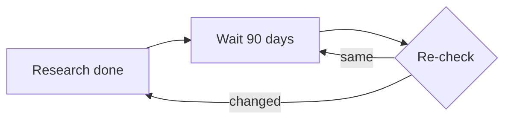
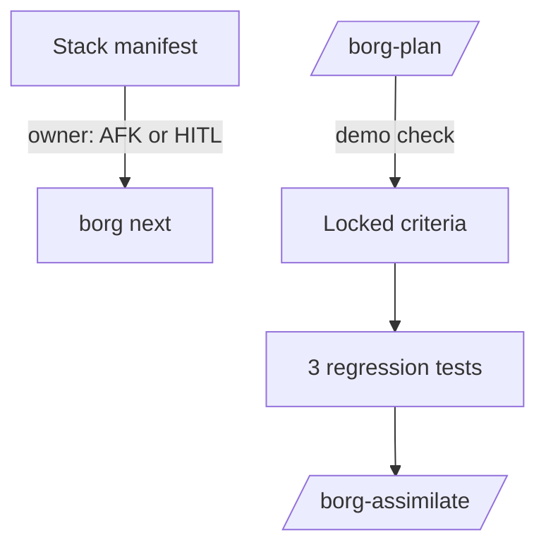
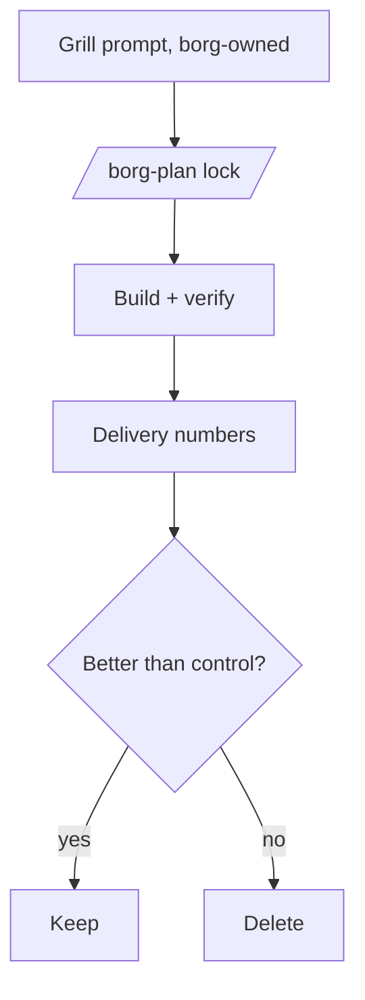
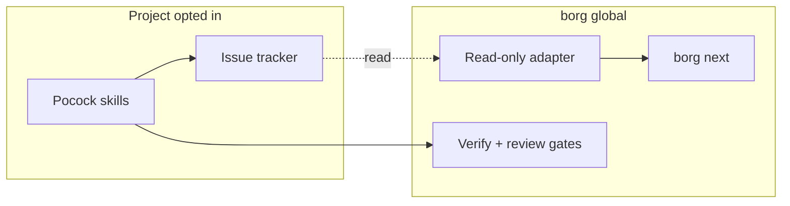

Generated: 2026-10-13

# Options and council: what should borg adopt, borrow, adapt, or skip from Matt Pocock's skills?

Draft for the decision-design step (D3, D3.5, D4). Not yet blind-reviewed: stamp `NOT design-reviewed` until the D5 pass runs.

Evidence base: the track synthesis in `analysis.md` (section keys like 4.4 point there). Prior work was catalogued and quarantined in `drafts/prior-work.md`; the options in section 1 were generated from zero, then checked against it in section 5.

## Glossary

- **AFK / HITL**: away from keyboard (agent works alone) versus human in the loop.
- **Tracer bullet / vertical slice**: a thin piece of work through every layer that can be demoed alone.
- **Frontier**: tickets whose blockers are all done.
- **Stack**: borg's manifest chain of ordered work items.
- **Separation move**: one of four TRIZ-style ways to hold two opposed demands: in time, space, condition, or scale.
- **Drone / queen**: borg's per-project session and the orchestrator session.

## The decision and the two constraints

Decision: what borg should adopt, borrow, adapt, or skip from the Pocock library, given native Claude Code features and Noah's Cortex Code use.

Frame from the evidence (analysis 3): three layers. Mechanics are native, process is Matt's skills, control is borg. His repo has no cross-project, gating, or deploy layer (4.3).

One genuine tension surfaced:

- Pole 1, reuse the popular shared process library: it carries 289k stars of practitioner mileage, the grill/slice ideas, and a free update stream (4.1, 4.2).
- Pole 2, keep borg's visibility layer and the fewest moving parts: the library ships breaking renames as minor versions (4.1), overlapping skill descriptions cause selection failures (4.5), and its own tracker shows stale-state failures (4.4). Adding it widens the surface Noah must keep honest.

## 1. Options (generated from zero)

### Option A: Skip and watch

- **What it is:** Change nothing in borg. Record the comparison, set a 90-day re-check, and leave Matt's pack alone.
- **How it works:** Calendar a review. Cite counts only with dates. No install, no edits.
- **Pros / Cons:**
  - Pro: zero new surface; no name collisions with Claude Code built-ins (4.5).
  - Pro: the evidence says no outcome study exists, so waiting loses little (4.2).
  - Con: leaves two cheap, concrete findings on the table (AFK/HITL label, demo check) (4.4).
  - Con: the three planning-state failure cases go untested against borg.
- **Key tradeoffs:** concedes the chance to learn from a fast-moving peer; concedes a quick win on "what can I leave alone?".
- **Feasibility:** High. Nothing to build.
- **Estimate:** 0.1 session.
- **Visual:**

- **Minimum viable version:** The smallest version that delivers the core value is: one dated line in the project plan, "re-check Pocock pack on 2027-01-11".

### Option B: Borrow three ideas, build nothing external

- **What it is:** Take the small ideas, not the files. Add an AFK/HITL owner label to stack items; add a "what can I demo when this is done?" plus a breakdown completeness check to /borg-plan; write regression checks for his three reported failures.
- **How it works:** The label is one field in the manifest and one column in `borg next`. The demo check is a question in the plan step with a failing-at-start Verify line. The three checks are tests: does assimilate close the item, can two drones claim one item, does a locked decision update dependents.
- **Pros / Cons:**
  - Pro: all three are inference-backed by his own tracker (4.4), and each is small.
  - Pro: no dependency on his release cadence or names.
  - Pro: the label feeds WAITING ON YOU directly.
  - Con: stays untested against delivery numbers; borrowed ideas may not help (4.4 "what's missing").
  - Con: grilling, his most-cited skill, is not touched.
- **Key tradeoffs:** concedes the grilling pass and any shared-glossary gain; accepts that the checks exist only as far as borg writes them.
- **Feasibility:** High. The label is a manifest field; the failure cases map onto existing assimilate and stack code (4.3).
- **Estimate:** 2 to 3 sessions.
- **Visual:**

- **Minimum viable version:** The smallest version that delivers the core value is: the AFK/HITL field and its display in `borg next`; nothing else.

### Option C: Install the pack globally as borg's process layer

- **What it is:** Install `mattpocock/skills` on every machine. Route /borg-plan through his grill and `to-tickets`; let his triage labels become borg's work-item states.
- **How it works:** Plugin from the official marketplace at a pinned commit (4.5). /borg-plan calls the skills; borg's gates and checkpoints wrap them.
- **Pros / Cons:**
  - Pro: instant access to the grill, spec, slicing, and glossary habits with an upstream author.
  - Pro: pinned plugin install gives a lockfile-like guarantee (4.5).
  - Con: his `/code-review` and `/prototype` collide with built-ins (4.5).
  - Con: renames shipped as minor versions (v1.1, v1.3) break cross-references (4.1).
  - Con: tracker-coupled skills assume GitHub or GitLab issues as the state store, which makes a second planning surface next to borg manifests.
  - Con: the pack's README argues against process-owning tools, while borg is one (4.3).
- **Key tradeoffs:** concedes the fewest-moving-parts constraint and gives a third party control over wording of the planning step.
- **Feasibility:** Medium. The install is easy; reconciling two state stores and name audits is not (4.3, 4.5).
- **Estimate:** 6 to 8 sessions.
- **Visual:**

- **Minimum viable version:** The smallest version that delivers the core value is: install into one project only, user-invoked, namespaced, with no change to /borg-plan.

### Option D: Measured grilling pilot with skill evals

- **What it is:** Treat the grill-spec-slice chain as a hypothesis. Run a grill pass before criteria lock on two or three projects for about six weeks and compare against the six delivery numbers. Also write evals for borg's own skills.
- **How it works:** A short borg-owned grill prompt (plain text, written fresh, not his file) runs before /borg-plan locks criteria. Record per-plan: rework before merge, criteria changed after lock, time to merge. Add with/without evals for the grill and the demo check.
- **Pros / Cons:**
  - Pro: answers the one question no source answers (4.2, 4.4 "what's missing").
  - Pro: consistent with "enforce first, measure second" and with a randomized trial showing self-report is unreliable (4.4).
  - Pro: evals are a differentiator, since his repo has none (4.2, 4.5).
  - Con: slow; six weeks before a verdict.
  - Con: small samples across a few projects give weak signal.
  - Con: adds a measurement job to a solo operator.
- **Key tradeoffs:** concedes speed of adoption; accepts that the answer may be "no gain".
- **Feasibility:** Medium. The delivery numbers exist in design only (4.4).
- **Estimate:** 4 to 5 sessions plus six weeks of elapsed time.
- **Visual:**

- **Minimum viable version:** The smallest version that delivers the core value is: grill prompt on one project for four plans, logging three numbers by hand.

### Option E: Per-project opt-in lane with read-only tracker view

- **What it is:** Keep the pack out of borg's core. Let a project opt in to the Pocock process lane (pack installed in that project only, user-invoked, namespaced), while borg only reads that lane's issue state into `borg next` and never writes to it. Projects that stay on /borg-plan are untouched.
- **How it works:** A manifest flag `process: pocock` per project. A read-only adapter lists `ready-for-agent` and `ready-for-human` issues and blocking edges into the stack view as AFK/HITL rows. borg gates (verify, blind review, assimilate) apply to any lane at merge time.
- **Separation move:** by scale, with space. Process stays per project (part, where the pack is strong: one session, one repo). Control stays global (whole, where borg is strong). The shared library supplies process; borg supplies visibility; the two never write the same state.
- **Ideal Final Result:** Noah gets the pack's slicing and triage habits where they help, without borg owning its names, state, or updates, using the issue tracker and borg's existing views already present.
- **Pros / Cons:**
  - Pro: holds both poles. The library is used where it fits; borg's visibility and fewest-moving-parts stay global (4.3, 3).
  - Pro: read-only adapter avoids a second write surface, the cairn lesson in prior work.
  - Pro: opt-in limits name-collision blast radius (4.5).
  - Con: two lanes means two mental models for 20 projects.
  - Con: the adapter depends on label names the maintainer may rename (4.1); each rename is a borg bug.
  - Con: Cortex does not honor the lane well (tracker-coupled skills do not port, 4.6).
- **Key tradeoffs:** concedes a single uniform workflow; accepts adapter upkeep as the price of interoperability.
- **Feasibility:** Medium. Triage labels and blocking links are documented (4.4), but nothing shows a read adapter exists or stays stable.
- **Estimate:** 5 to 6 sessions.
- **Visual:**

- **Minimum viable version:** The smallest version that delivers the core value is: one project opted in, a read-only listing of its `ready-for-agent` issues in `borg next`, no writes.

## 2. Contradiction forge (D3.5)

The tension is real: reuse a popular shared library versus keep borg's visibility layer and few moving parts. Options A and B concede the first pole. Option C concedes the second. Option E is the both-poles option.

- **Test for a relabeled trade-off:** E would be a re-skin if it just made C optional. It is not, because it adds a different thing: a read-only boundary. The library may not write borg state, and borg may not write library state. The separation is by scale (process per part, control for the whole) and space (different surfaces).
- **Weak point:** an adapter still pays the cost of tracking upstream names. E holds both poles only if that cost stays small. No primary evidence exists that it does: stamp E `NO PRIMARY EVIDENCE` on stability until the MVP runs for one release cycle.
- Option D is not a resolution; it defers the choice behind a measurement.

## 3. Council (D4)

Each persona speaks once.

**Product Strategist.** The question is whether this solves borg's job, which is to tell Noah what is next across about 20 projects. The pack does not do that and says so (4.3). So any option that makes borg more like the pack is the wrong product move; B and D keep borg's identity. I rank B first, D second. I KILL Option C on strategic grounds, not effort: borg would hand its planning step to a single-author repo whose README argues against process-owning tools (4.3), and whose renames break dependents (4.1).

**Technical Realist.** B is trivial: a field plus three tests. D is tractable but the six delivery numbers do not exist yet (4.4), so the pilot can't be read until they do. E is the one that worries me: an adapter parsing another project's label vocabulary breaks on a minor-version rename (4.1, v1.1 and v1.3), and nobody has tested a read-only view. C creates two state stores. Hidden complexity in B: the double-claim check (issue 476) only matters if borg really has shared claims; check first.

**User Advocate (solo, terminal-first, ADHD-aware).** What matters is load. The AFK/HITL label answers "can I walk away?" at a glance, and it feeds WAITING ON YOU (4.4); that is a direct win. The demo check is one question, cheap. A second workflow lane (E) puts a decision at the start of every project: which lane is this? That is the exact choice-fatigue to avoid. D adds a measurement chore, which I accept only if it is nearly automatic. I DISSENT from E: the lane flag looks small but adds a permanent per-project branch in the head. Noah's stated purpose for borg is to manage the chaos and keep him knowing what is next, so attention is the scarce resource.

**Pragmatist.** 80/20: B delivers most of what the evidence calls actionable in 2 to 3 sessions. Of the analysis recommendations, five are B-shaped. D's cost is mostly elapsed time, so start it cheaply: one project, hand-logged. A is correct for everything B does not cover. Infra is already 79% of merged PRs and guidance is maintain, do not expand (prior work), so each addition names a deletion. I would scope B hard: label first, tests second, demo check third, stop.

**Recommender.** Picks Option B, scoped, with a seeded D hook.

Scope constraint: build in this order and stop at any step that fails review. (1) AFK/HITL field in the manifest and `borg next`. (2) The three regression checks, written as failing tests first. (3) The demo question in /borg-plan, with a Verify line that must fail at the starting commit. Record one hand-logged grilling trial on one project as the only D element; do not build the pilot machinery yet. Cortex: a scratch-directory install attempt at work, informational only, outside this directive.

Strongest dissent engaged: the Product Strategist's kill of C stands and I accept it. The User Advocate's dissent against E stands too; E is not chosen and its adapter stability remains `NO PRIMARY EVIDENCE`. The strongest remaining objection to B is the Technical Realist's: B may just fix problems borg does not have (for example, claim races). Answer: step 2 begins by testing whether the problem exists in borg; a passing test is the result, and it deletes the associated item from scope. A second objection, from the evidence, is that B rests on no outcome data. True, and that is why B is labeled borrowing small, reversible ideas, not a methodology adoption.

Why not the lowest-effort option: A is cheaper, but it skips two findings the evidence supports with primary sources (the AFK label, the demo check), so effort alone does not pick B over A.

## 4. Summary table

| Option | One line |
|--------|----------|
| A | Skip and re-check in 90 days |
| B | Borrow label, demo check, 3 regression tests |
| C | Install the pack as borg's process layer |
| D | Six-week measured grilling pilot plus evals |
| E | Per-project opt-in lane, read-only view (forge) |

## 5. Check against quarantined prior work

Done after generation.

- **Consistent with the live rule** "adopt prompts and stateless pieces, not new state stores; every adoption names a deletion PR": B and D comply; E complies only because the adapter is read-only; C violates it (second planning store).
- **Consistent with the cairn lesson** (volunteered second write surfaces died): C and any glossary file are exposed; B adds only a field to an existing manifest.
- **Consistent with the evals-for-everything directive** (Phase 1 unshipped): D lines up and could reuse it; sequencing D's machinery behind that directive is sensible.
- **Prior stance on peer frameworks** (Superpowers: cherry-pick the prompt, do not install wholesale): B is the same pattern applied to the Pocock pack, so the recommendation is not novel for borg.
- **Gap overlap:** prior work lists no shared glossary and no test-first enforcement; Matt's pack addresses both, which is the case for D, and the reason a glossary is a later question, not part of B.
- **No option was changed** after this check; B's scope step 2 (tests first) was already in the draft.

## 6. Open items for D5

- Blind reviewer to test: is there a missed option (for example, "use native features only" or "adopt only grilling")?
- Whether B step 2's claim-race test applies to borg at all.
- Cortex trial stays outside this decision.
