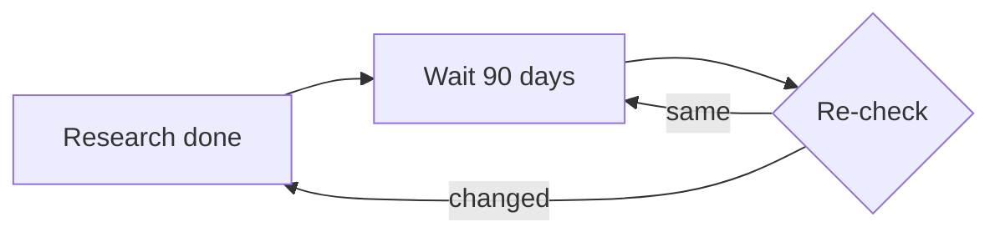
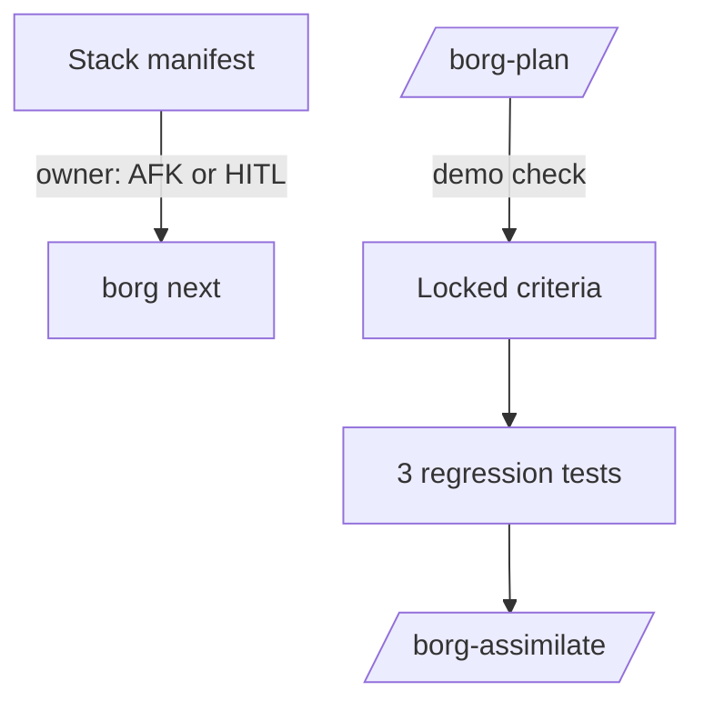
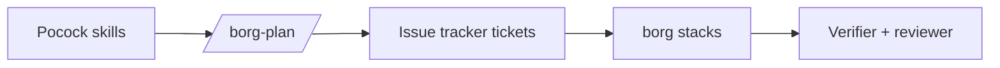
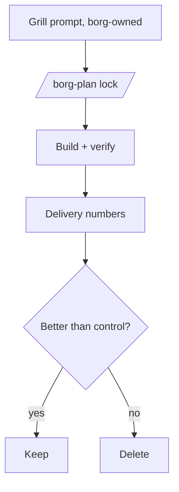
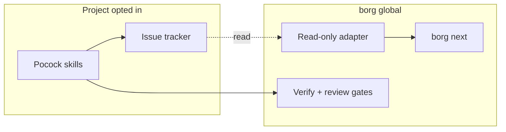
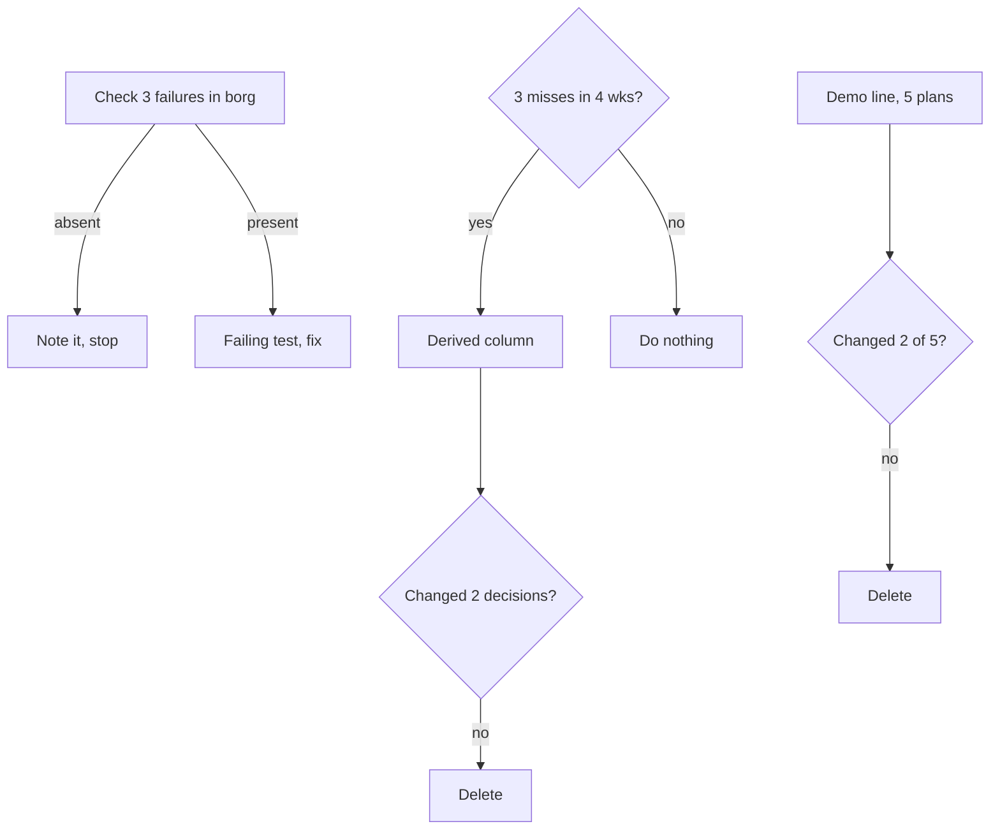

Generated: 2026-10-13

# Options and council: what should borg adopt, borrow, adapt, or skip from Matt Pocock's skills?

Draft for the decision-design step (D3, D3.5, D4). Revised after blind review round 1 returned "revise" on Option B: options F and A-plus added, council rerun, pick changed to F. Stamp `NOT design-reviewed` until the D5 pass reruns.

Evidence base: the track synthesis in `analysis.md` (section keys like 4.4 point there). Prior work was catalogued and quarantined in `drafts/prior-work.md`; the options in section 1 were generated from zero, then checked against it in section 5.

## Glossary

- **AFK / HITL**: away from keyboard (agent works alone) versus human in the loop.
- **Tracer bullet / vertical slice**: a thin piece of work through every layer that can be demoed alone.
- **Frontier**: tickets whose blockers are all done.
- **Stack**: borg's manifest chain of ordered work items.
- **Separation move**: one of four TRIZ-style ways to hold two opposed demands: in time, space, condition, or scale.
- **Drone / queen**: borg's per-project session and the orchestrator session.

## The decision and the two constraints

Decision: what borg should adopt, borrow, adapt, or skip from the Pocock library, given native Claude Code features and Noah's Cortex Code use.

Frame from the evidence (analysis 3): three layers. Mechanics are native, process is Matt's skills, control is borg. His repo has no cross-project, gating, or deploy layer (4.3).

One genuine tension surfaced:

- Pole 1, reuse the popular shared process library: it carries 289k stars of practitioner mileage, the grill/slice ideas, and a free update stream (4.1, 4.2).
- Pole 2, keep borg's visibility layer and the fewest moving parts: the library ships breaking renames as minor versions (4.1), overlapping skill descriptions cause selection failures (4.5), and its own tracker shows stale-state failures (4.4). Adding it widens the surface Noah must keep honest.

## 1. Options (generated from zero)

### Option A: Skip and watch

- **What it is:** Change nothing in borg. Record the comparison, set a 90-day re-check, and leave Matt's pack alone.
- **How it works:** Calendar a review. Cite counts only with dates. No install, no edits.
- **Pros / Cons:**
  - Pro: zero new surface; no name collisions with Claude Code built-ins (4.5).
  - Pro: the evidence says no outcome study exists, so waiting loses little (4.2).
  - Con: leaves two cheap, concrete findings on the table (AFK/HITL label, demo check) (4.4).
  - Con: the three planning-state failure cases go untested against borg.
- **Key tradeoffs:** concedes the chance to learn from a fast-moving peer; concedes a quick win on "what can I leave alone?".
- **Feasibility:** High. Nothing to build.
- **Estimate:** 0.1 session.
- **Visual:**

- **Minimum viable version:** The smallest version that delivers the core value is: one dated line in the project plan, "re-check Pocock pack on 2027-01-11".

### Option B: Borrow three ideas, build nothing external

- **What it is:** Take the small ideas, not the files. Add an AFK/HITL owner label to stack items; add a "what can I demo when this is done?" plus a breakdown completeness check to /borg-plan; write regression checks for his three reported failures.
- **How it works:** The label is one field in the manifest and one column in `borg next`. The demo check is a question in the plan step with a failing-at-start Verify line. The three checks are tests: does assimilate close the item, can two drones claim one item, does a locked decision update dependents.
- **Pros / Cons:**
  - Pro: all three are inference-backed by his own tracker (4.4), and each is small.
  - Pro: no dependency on his release cadence or names.
  - Pro: the label feeds WAITING ON YOU directly.
  - Con: stays untested against delivery numbers; borrowed ideas may not help (4.4 "what's missing").
  - Con: grilling, his most-cited skill, is not touched.
- **Key tradeoffs:** concedes the grilling pass and any shared-glossary gain; accepts that the checks exist only as far as borg writes them.
- **Feasibility:** High. The label is a manifest field; the failure cases map onto existing assimilate and stack code (4.3).
- **Estimate:** 2 to 3 sessions.
- **Visual:**

- **Minimum viable version:** The smallest version that delivers the core value is: the AFK/HITL field and its display in `borg next`; nothing else.

### Option C: Install the pack globally as borg's process layer

- **What it is:** Install `mattpocock/skills` on every machine. Route /borg-plan through his grill and `to-tickets`; let his triage labels become borg's work-item states.
- **How it works:** Plugin from the official marketplace at a pinned commit (4.5). /borg-plan calls the skills; borg's gates and checkpoints wrap them.
- **Pros / Cons:**
  - Pro: instant access to the grill, spec, slicing, and glossary habits with an upstream author.
  - Pro: pinned plugin install gives a lockfile-like guarantee (4.5).
  - Con: his `/code-review` and `/prototype` collide with built-ins (4.5).
  - Con: renames shipped as minor versions (v1.1, v1.3) break cross-references (4.1).
  - Con: tracker-coupled skills assume GitHub or GitLab issues as the state store, which makes a second planning surface next to borg manifests.
  - Con: the pack's README argues against process-owning tools, while borg is one (4.3).
- **Key tradeoffs:** concedes the fewest-moving-parts constraint and gives a third party control over wording of the planning step.
- **Feasibility:** Medium. The install is easy; reconciling two state stores and name audits is not (4.3, 4.5).
- **Estimate:** 6 to 8 sessions.
- **Visual:**

- **Minimum viable version:** The smallest version that delivers the core value is: install into one project only, user-invoked, namespaced, with no change to /borg-plan.

### Option D: Measured grilling pilot with skill evals

- **What it is:** Treat the grill-spec-slice chain as a hypothesis. Run a grill pass before criteria lock on two or three projects for about six weeks and compare against the six delivery numbers. Also write evals for borg's own skills.
- **How it works:** A short borg-owned grill prompt (plain text, written fresh, not his file) runs before /borg-plan locks criteria. Record per-plan: rework before merge, criteria changed after lock, time to merge. Add with/without evals for the grill and the demo check.
- **Pros / Cons:**
  - Pro: answers the one question no source answers (4.2, 4.4 "what's missing").
  - Pro: consistent with "enforce first, measure second" and with a randomized trial showing self-report is unreliable (4.4).
  - Pro: evals are a differentiator, since his repo has none (4.2, 4.5).
  - Con: slow; six weeks before a verdict.
  - Con: small samples across a few projects give weak signal.
  - Con: adds a measurement job to a solo operator.
- **Key tradeoffs:** concedes speed of adoption; accepts that the answer may be "no gain".
- **Feasibility:** Medium. The delivery numbers exist in design only (4.4).
- **Estimate:** 4 to 5 sessions plus six weeks of elapsed time.
- **Visual:**

- **Minimum viable version:** The smallest version that delivers the core value is: grill prompt on one project for four plans, logging three numbers by hand.

### Option E: Per-project opt-in lane with read-only tracker view

- **What it is:** Keep the pack out of borg's core. Let a project opt in to the Pocock process lane (pack installed in that project only, user-invoked, namespaced), while borg only reads that lane's issue state into `borg next` and never writes to it. Projects that stay on /borg-plan are untouched.
- **How it works:** A manifest flag `process: pocock` per project. A read-only adapter lists `ready-for-agent` and `ready-for-human` issues and blocking edges into the stack view as AFK/HITL rows. borg gates (verify, blind review, assimilate) apply to any lane at merge time.
- **Separation move:** by scale, with space. Process stays per project (part, where the pack is strong: one session, one repo). Control stays global (whole, where borg is strong). The shared library supplies process; borg supplies visibility; the two never write the same state.
- **Ideal Final Result:** Noah gets the pack's slicing and triage habits where they help, without borg owning its names, state, or updates, using the issue tracker and borg's existing views already present.
- **Pros / Cons:**
  - Pro: holds both poles. The library is used where it fits; borg's visibility and fewest-moving-parts stay global (4.3, 3).
  - Pro: read-only adapter avoids a second write surface, the cairn lesson in prior work.
  - Pro: opt-in limits name-collision blast radius (4.5).
  - Con: two lanes means two mental models for 20 projects.
  - Con: the adapter depends on label names the maintainer may rename (4.1); each rename is a borg bug.
  - Con: Cortex does not honor the lane well (tracker-coupled skills do not port, 4.6).
- **Key tradeoffs:** concedes a single uniform workflow; accepts adapter upkeep as the price of interoperability.
- **Feasibility:** Medium. Triage labels and blocking links are documented (4.4), but nothing shows a read adapter exists or stays stable.
- **Estimate:** 5 to 6 sessions.
- **Visual:**

- **Minimum viable version:** The smallest version that delivers the core value is: one project opted in, a read-only listing of its `ready-for-agent` issues in `borg next`, no writes.

### Option F: B-minus, check-first with evidence gates (added after blind review)

- **What it is:** The smallest version of B. Only step 2 is unconditional: check whether the three observed failures can happen in borg's file-based stacks. The AFK/HITL label and the demo question are not built up front; each has an entry gate, a post-hoc check, a kill criterion, and a named deletion.
- **How it works:**
  - Step 1 (unconditional, check-first): for each of the three reported failures (issues 508, 476, 828), read borg's assimilate, claim, and decision-update code and try to reproduce the failure with a failing test. Each case ends one of two ways. If borg cannot exhibit it (for example, borg has no assignee-as-claim and no open/closed issue state), write one line in the decision record, "does not exist in borg", write no test, and stop that case. If borg can, a failing test comes first, then the fix. Zero tests is a valid and expected outcome for a case.
  - Step 2 (gated, label): do not add a field. First, for four weeks, tally each time WAITING ON YOU plus the board Owner field fails to answer "can I walk away from this?". Gate: at least 3 such misses. If the gate passes, show the answer as a derived column in `borg next` computed from the existing owner signal, not a new manifest field that must be kept current. Post-hoc check at week 4 after shipping: did the column change a "what is next" decision at least twice (hand tally)? If not, delete it. Deletion paired: any column or text it displaces in `borg next` is removed, not added beside.
  - Step 3 (gated, demo question): one line in /borg-plan, tried on the next 5 plans, with a Verify line that fails at the starting commit. Post-hoc check: in how many of the 5 did the answer change a slice, a criterion, or an order? If 0 or 1 of 5, delete the line. Deletion paired: it replaces one existing /borg-plan question rather than adding a ninth. Labelled anecdote; 5 plans without a baseline are not evidence the question works.
  - Seeded D trial: dropped from the directive. Any grilling trial Noah runs is logged as anecdote and counted as zero evidence toward D. D stays a separate decision.
- **Pros / Cons:**
  - Pro: the only unconditional work is tied to concrete observed failures, and it can end in "nothing to do".
  - Pro: every addition has a gate, a measurable post-hoc check, and a kill criterion; every addition names a deletion.
  - Pro: no new state that can go stale (the label is derived).
  - Con: slower to the quick wins; the label may ship only after four weeks of tallying, or never.
  - Con: the tally is a small measurement chore (a one-line note when it happens).
  - Con: thresholds (3 misses, 2 changed decisions, 2 of 5 plans) are judgment calls, not derived from data.
- **Key tradeoffs:** concedes speed and the grilling pass; accepts that most of the directive may be deleted by its own checks.
- **Feasibility:** High. Step 1 is reading and at most a few tests.
- **Estimate:** 0.5 to 1 session for step 1; steps 2 and 3 only if gated in.
- **Visual:**

- **Minimum viable version:** The smallest version that delivers the core value is: step 1 for issue 476 only (the claim race), ending in a note or a failing test.

### Option A-plus: borrow nothing, with an explicit stop rule (added after blind review)

- **What it is:** A, but with a rule that ends the topic instead of leaving it open. Record the comparison; log any real borg planning-state failure as it occurs; on 2027-01-11 re-check once. If no concrete borg failure of the kinds seen in his tracker or of "I could not tell what to do next" was logged, close the topic for 12 months and do not re-research.
- **How it works:** One dated line in the project plan and a one-line log file for incidents. No code.
- **Pros / Cons:**
  - Pro: the same zero new surface as A, and the open-ended "watch" becomes bounded.
  - Pro: any later adoption starts from a real borg failure, which is the evidence B and F lack.
  - Con: passive; depends on Noah noticing and logging failures, which the ADHD-aware User Advocate expects to lapse.
  - Con: leaves the cheap observed-failure check (F step 1) undone.
- **Key tradeoffs:** concedes any learning from the peer until a failure forces it.
- **Feasibility:** High.
- **Estimate:** 0.1 session.
- **Minimum viable version:** The smallest version that delivers the core value is: the dated re-check line plus the stop rule sentence.

## 2. Contradiction forge (D3.5)

The tension is real: reuse a popular shared library versus keep borg's visibility layer and few moving parts. Options A and B concede the first pole. Option C concedes the second. Option E is the both-poles option.

- **Test for a relabeled trade-off:** E would be a re-skin if it just made C optional. It is not, because it adds a different thing: a read-only boundary. The library may not write borg state, and borg may not write library state. The separation is by scale (process per part, control for the whole) and space (different surfaces).
- **Weak point:** an adapter still pays the cost of tracking upstream names. E holds both poles only if that cost stays small. No primary evidence exists that it does: stamp E `NO PRIMARY EVIDENCE` on stability until the MVP runs for one release cycle.
- Option D is not a resolution; it defers the choice behind a measurement.

## 3. Council (D4), round 2 with the blind-review objection on the table

Round 1 picked B. The blind reviewer returned "revise". The objection, in short: B rests on Pocock's own docs and tracker, not on evidence it helps borg; steps 1 and 3 have no success measure or kill criterion; the AFK/HITL label may duplicate WAITING ON YOU and the Owner=Noah/Owner=Orchestrator board field and adds a field that can go stale; the demo question is novel and unsupported; the three failure tests come from a GitHub-tracker design (assignee claims, open/closed state) and may not apply to file-based stacks; no deletion is paired with any addition; the seeded D trial is n=1 with no baseline; and two options were missed (B-minus, and a borrow-nothing A with a stop rule). Options F and A-plus above answer the last point. Each persona speaks once.

**Product Strategist.** The reviewer is right that the label restates a distinction borg already makes. borg's job is telling Noah what is next; if WAITING ON YOU already does that, the label is a second encoding. Rank F first, A-plus second, B third. C stays killed (single-author dependency, README argues against process-owning tools, 4.3). I accept that evidence from his tracker is evidence about his tracker.

**Technical Realist.** The three failures are tracker-design failures: assignee-as-claim, open/closed state, and a decision lock that does not propagate. borg has manifests and files, so I expect at least two of the three to not exist here. So the right first act is a read of the code, and the right outcome of that read may be "no test". Writing a test borg cannot fail is waste. F step 1 is correct. E adapter stability remains `NO PRIMARY EVIDENCE`.

**User Advocate (solo, terminal-first, ADHD-aware).** I defended the label in round 1 and I withdraw that as an up-front build. A derived column costs nothing to maintain and cannot go stale; a hand-kept field can. I accept the label only as a derived view, and only after the tally says the existing signal misses. My concern with A-plus: it relies on remembering to log. F's tally has the same flaw, so keep it to one line. I still DISSENT from E (permanent lane choice per project).

**Pragmatist.** 80/20: the 80 is step 1, and it may finish in under a session with a note. Infra is already about 79% of merged PRs and guidance is maintain, do not expand, so the rule "every addition names a deletion" is binding. Thresholds are guesses; state them as guesses and let them be edited. If F's gates all fail, the result is A-plus, and that is fine.

**Recommender.** Picks Option F, with A-plus's stop rule as its fallback.

Direct answer to the objection, point by point:

- No outcome evidence for the borrowed ideas: conceded. F does not claim benefit. It claims only that observed failures in a peer's tracker are worth checking against borg, and it builds nothing that the check or a gate does not call for.
- No success measure or kill criterion for steps 1 and 3 of B: fixed. In F each build step has an entry gate, a hand-tallied post-hoc check with a number, and a delete-if-it-fails rule (see F). The numbers are judgment calls, flagged as such.
- Label duplicates WAITING ON YOU and the Owner field, and can go stale: accepted. F gates the label on at least 3 recorded misses of the existing signal, and builds it as a derived column, not a new field.
- Demo question unsupported: accepted. F treats it as a 5-plan trial, labelled anecdote, deleted if it changes a plan in fewer than 2 of 5. The failing-at-start Verify line stays as a gate on the check itself; it does not prove the question improves plans.
- Failures come from a GitHub-tracker design: accepted. F states that "the problem does not exist in borg" ends the case with no test written. Step 1 is the only unconditional work.
- No deletion paired: fixed. The label displaces existing `borg next` text; the demo line replaces an existing /borg-plan question; if gates fail, nothing is added.
- Seeded D trial is n=1 and cannot beat novelty: accepted. Dropped from the directive; any trial is anecdote and counts zero toward D.
- Missed options: added as F (B-minus) and A-plus.

Why not A-plus alone: it is a legitimate floor, but it skips F step 1, a half-session check tied to concrete observed failures; and A-plus depends on passive logging. Why not B as written: the reviewer's objection stands on the points above. If F's step 1 finds no failure and both gates fail, F collapses to A-plus; that is an acceptable result, not a defect.

Remaining weak point: F's thresholds (3 misses, 2 changed decisions, 2 of 5 plans) are arbitrary. They are written down so they can be checked later and changed, not defended.

## 4. Summary table

| Option | One line |
|--------|----------|
| A | Skip and re-check in 90 days |
| A-plus | Skip, log failures, stop rule at re-check |
| B | Borrow label, demo check, 3 regression tests |
| C | Install the pack as borg's process layer |
| D | Six-week measured grilling pilot plus evals |
| E | Per-project opt-in lane, read-only view |
| F | Check-first, gated additions, paired deletions |

Pick: F (fallback A-plus). B is superseded.

## 5. Check against quarantined prior work

Done after generation (round 1; F and A-plus re-checked).

- **Live rule** "adopt prompts and stateless pieces, not new state stores; every adoption names a deletion PR": F complies and makes the deletion explicit per step; B only implied it; C violates it (second planning store); E complies only because the adapter is read-only.
- **Cairn lesson** (volunteered second write surfaces died): F's label is derived, so it adds no write surface; B's manifest field would have.
- **Evals-for-everything directive** (Phase 1 unshipped): D lines up and could reuse it; sequence D behind it.
- **Prior stance on peer frameworks** (cherry-pick the prompt, do not install wholesale): F is the same pattern with gates.
- **Gap overlap:** prior work lists no shared glossary and no test-first enforcement; the pack addresses both, which is the case for D, a separate decision.

## 6. Open items for D5 (round 2)

- Blind reviewer to check: does F answer each of the seven issues, and are the thresholds acceptable as stated guesses?
- Whether the check-first reading of issues 508, 476, and 828 against borg code has been done yet; it has not, so F step 1 is the next action.
- Cortex trial stays outside this decision.
- Status: `NOT design-reviewed` for round 2 until the D5 pass reruns.
