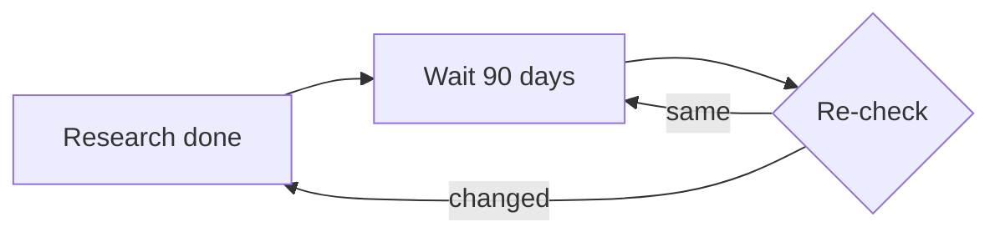
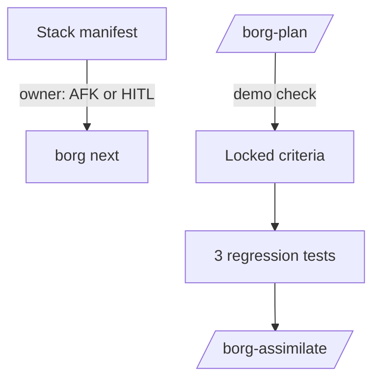
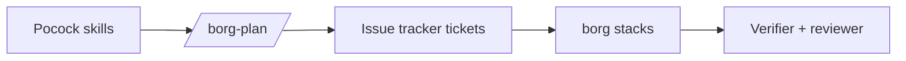
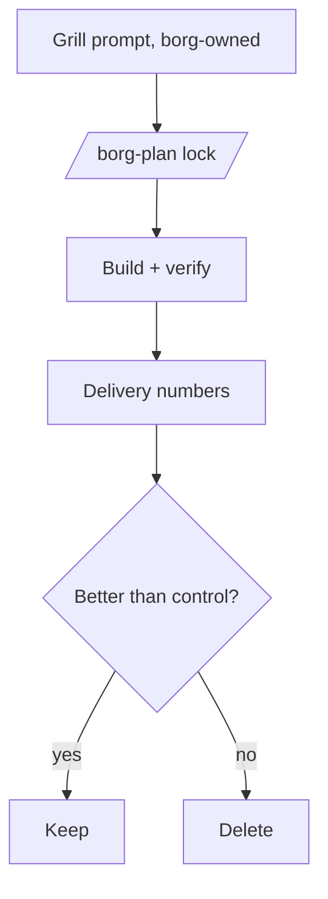
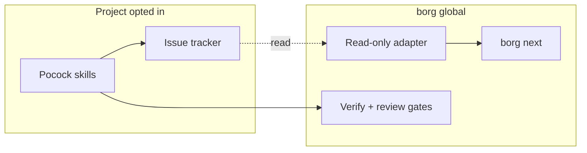
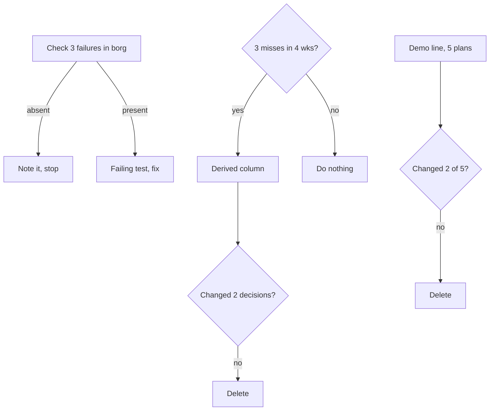

Generated: 2026-10-13
AI-scoring: 80/100

# What borg should take from Matt Pocock's skills

## Glossary

- **Agent Skills**: the shared SKILL.md file format that Claude Code, Cortex Code CLI and many other tools read.
- **AFK / HITL**: away from keyboard (the agent works alone) versus human in the loop.
- **Tracer bullet / vertical slice**: a thin piece of work through every layer that can be demoed on its own.
- **Frontier**: the tickets whose blockers are all done, so they can start now.
- **Stack**: borg's manifest chain of ordered work items.
- **Drone / queen**: borg's per-project session and the orchestrator session.
- **Failure class**: the shape of a failure (a lost update, a missing done-signal), independent of the mechanism that causes it.
- **Probe**: a test written in borg's own terms that tries to produce one failure class and is kept as a regression test.
- **Gate**: an entry condition an addition must meet before it is built.
- **Kill criterion**: a measured result that triggers deleting the addition.
- **Derived column**: a display computed from signals borg already keeps, with no new field to maintain.
- **Option F / A-plus**: the check-first option with gated additions, and the borrow-nothing option with a stop rule.

## Recommendation

**Decision (Noah, 2026-10-13):** adopt the round-3 blind reviewer's variant instead of Option F. Borrow nothing as "adoption". Fold the three tracker failure cases (finished work never marked done, two sessions claiming or overwriting the same item, a locked decision not reaching dependent items) into the existing manifest lost-update directive (docs/plans/directives/2026-10-12-manifest-writer-lost-update-guard.md) plus an audit of every code path that changes an item's state (assimilate, close, add-row, manual merge, hooks). Keep the AFK/HITL label and the demo check as log-triggered maybes (Option A-plus triggers), and re-check on 2027-01-11.

**NOT upheld by blind review after 3 rounds.** The recommendation below is not upheld by blind review after 3 rounds. Round 1 returned "revise" on Option B. Round 2 returned "revise" on F. Round 3 reviewed the amended F and also returned "revise". The council's pick stays Option F as amended, with A-plus as the fallback, and the open round-3 objection is listed below for Noah to decide. The amended F is not design-reviewed and upheld.

**Round-3 verdict: revise.** Strongest objection, verbatim:

> "The amendment relocates the round-2 defect instead of removing it. Step 1 now says \"absent\" means a probe ran and could not produce the failure. But each probe is still written in borg's mechanism, and the mechanism chosen is the one least likely to fail. The done-signal probe is \"run assimilate on a finished item; does the manifest entry change state\". The recommendation's own Prior Work says assimilate was used 2 times and \"most merges bypass it\". So the failure class, finished work never marked done so the frontier goes stale, is most plausibly present on the bypass path. A happy-path assimilate probe would pass and be recorded as \"absent\" with a retained test as false assurance. The lost-update probe has the same problem. Issue 476 is \"double-resolution + map lost-update\", but the probe covers only the double claim, and a single sequential run cannot show a race is absent. Borg already has a directive filed yesterday (docs/plans/directives/2026-10-12-manifest-writer-lost-update-guard.md) stating that the lost-update race in write_manifest is real and unlocked, so the 476 class is already known present. Finally, the amendment assigns probe authorship to the borg-verifier agent. That agent's tools are Bash, Read, Grep, Glob, with no Edit or Write, and its guard hook is hook-enforced read-only. It cannot write a test file. The central safeguard against self-confirmation therefore cannot run as specified. Nothing defines probe adequacy, such as covering every write path that mutates item state or stress-running races N times, so the \"who decides absent\" question from round 2 is still open."

**Open objections for Noah to decide:**

- Infeasible as specified: the read-only verifier agent (tools Bash, Read, Grep, Glob; read-only guard hook) cannot create a regression test file. Probe authorship has to move to a nanoprobe or the main loop, which reintroduces the "person who expects to find nothing" problem, or the verifier's role has to be redesigned.
- Mechanism-matching survives inside the probes: the 508 probe runs assimilate, but most merges bypass assimilate, so the likely failure path (manual merge, direct close, no close) goes untested. There is no adequacy rule such as "probe must exercise every writer of item state".
- The 476 probe is narrower than the issue, and a one-shot probe cannot show a race is absent; it needs forced interleaving or N-run stress.
- Redundant with existing work: the lost-update directive filed 2026-10-12 already establishes that class as present and specifies a forced-interleave test with mutation check. Step 1 should cite and fold into it, and the "absent / unknown" framing is stale for at least one of the three cases.
- A failing probe followed by a fix is unbounded: the 828 probe almost certainly fails today because no propagation mechanism exists, so the fix is a feature, not a patch. This collides with the 0.5-session estimate, the "maintain, do not expand" infra guidance and the "every addition names a deletion" rule, and there is no xfail or defer-with-ticket ending.
- Pocock-specificity is thin: the probes are generic hygiene on borg's own write paths and would be justified without his repo. What distinguishes F from A-plus is "run three tests Noah should run anyway", not anything borrowed.
- Evidence for the failure classes is asserted, not shown: the three source cards are n=1 reports, scored borderline (about 5.75 to 6.0), and "corroboration" means adjacent issues, not replication.
- Several Skip verdicts rest on assertion or an unreviewed document: "tdd" relies on the lifecycle-hybrid directive (Proposed, not design-reviewed); "diagnosing-bugs: no gap found" has no gap analysis in analysis.md; "retro: skip" sits next to borg's acknowledged Debriefs PM gap.
- Document hygiene: the Options section still carries the superseded F text ("absent -> note, stop"; "Zero tests is a valid and expected outcome"), so an implementer could follow the rejected rule.
- Missed option: fold F's step 1 into the existing manifest-writer directive plus an "every item-state writer" audit (assimilate, close, add-row, manual merge, hook paths), treat Pocock as a seed list only, and keep the two gated additions as A-plus's log triggers. Grilling remains undecided (deferred to D), leaving the library's most-cited skill outside this adopt/skip decision.

**Round-2 review, for the record.** The round-2 review of F raised the objection below. The amended F that follows was written in response.

The strongest objection to F, verbatim:

> "F's only unconditional step, which is also the sole reason to pick F over A-plus, decides \"absent\" by mechanism-matching rather than failure-class. The doc's own example is \"borg has no assignee-as-claim and no open/closed issue state\", so there is \"no test\" and the case stops. The three source issues describe failure classes that do not need a GitHub assignee. #476 is a lost update between two concurrent sessions that share one human identity (the card says \"claim-by-assignee is the only signal\" and that there is \"no re-verification between claim and resolve\"). #508 is a done-signal gap: finished work is never marked done, so the frontier goes stale. #828 is a decision lock that does not propagate to dependent items (the card says \"the ticket body is the only context a fresh session is guaranteed to load\"). Borg has about 20 concurrent drones writing shared manifests, an assimilate step that closes items, and locked decisions, so all three classes can plausibly occur in a file-based store. A file-based store may not have the specific mechanism, but it can have the same failure with a different mechanism. The artifact never defines what \"borg cannot exhibit it\" means, who decides it, or what reading would count. Its own Technical Realist pre-commits to \"I expect at least two of the three to not exist here\" before reading any code. A check that can end in a note with no test, run by the person who expects to find nothing, tends to confirm its own prior. F then \"collapses to A-plus\" with a false assurance that the failures were investigated."

The objection is right, and the fix is to change the rule rather than defend it. In the revised F, step 1 can no longer end in a note. Each of the three issues is restated as a failure class, and each class gets a probe written in borg's own terms. The lost update (issue 476): two drones for one project, same human identity, both pick the same stack item; does anything refuse the second claim or re-verify before it resolves the item? The missing done-signal (508): run assimilate on a finished item; does the manifest entry change state, and does the next-item view stop listing it? The unpropagated lock (828): lock a decision that removes a concept; does any open item that still describes the old concept get flagged or updated? "Absent" now means the probe ran and could not produce the failure, and the probe stays in the suite as a regression test. A case ends in a failing probe followed by a fix, or in a passing probe with its output recorded. A prose note with no test is no longer a valid ending. The probes are written and run by the read-only verifier agent from the failure-class statements, not by the person who expects to find nothing.

That change also answers the "collapses to A-plus" worry. Step 1 now always leaves artifacts behind (three probes, or fixes), which is the difference between F and A-plus that justifies the pick.

**The pick is Option F as revised, with A-plus as the fallback if every gate fails.** In five points:

1. Do the check-first step now: three failure-class probes against borg's stacks, about half a session, smallest version is the lost-update probe alone.
2. Build the AFK/HITL answer only if a four-week tally shows the existing WAITING ON YOU view and board Owner field miss it at least 3 times, and then only as a derived column in the next-item view, never as a new manifest field.
3. Try the "what can I demo when this is done?" line on the next 5 plans, delete it if it changes fewer than 2 of them, and let it replace an existing plan question instead of adding a ninth.
4. Install nothing from the pack, and do not run a grilling trial under this decision; grilling stays a separate decision (Option D) and any informal trial counts as anecdote.
5. If the probes pass and both gates fail, the outcome is A-plus with a dated re-check on 2027-01-11 and a 12-month close if nothing real was logged. That result is acceptable, and the thresholds (3 misses, 2 changed decisions, 2 of 5 plans) are judgment calls written down so they can be edited.

### Adopt, borrow, adapt, skip

Nothing is adopted outright. His pack sits under one session and borg sits over twenty, so the table sorts by what feeds borg's visibility layer. Skill names follow the repo as of v1.3.1 and have been renamed before, so check them at use time.

| Item | Verdict | Reason |
|------|---------|--------|
| Whole pack | Skip | Name clashes, second state store |
| grill-me | Adapt | Own prompt, only via Option D |
| to-spec | Skip | borg-plan locks criteria |
| to-tickets | Borrow | Demo-check idea, gated, 5 plans |
| triage | Borrow | AFK/HITL as derived column, gated |
| wayfinder | Borrow | Its 3 failures become probes |
| implement-spec | Skip | Native workflows, worktrees |
| tdd | Skip | Test-first already in borg directive |
| diagnosing-bugs | Skip | No gap found in borg |
| code-review | Skip | Collides with native command |
| prototype | Skip | Collides with native command |
| retro | Skip | Changes agent, not plan |
| GLOSSARY.md habit | Adapt | Real borg gap, fold into D |
| Sandcastle | Skip | Watch; spike if containers needed |

A few rows need more than a cell. The wayfinder row is the whole value of the check-first step, since borg takes his three reported failures as test cases and nothing else from that skill. The tdd skip is about files, not ideas: a test-first prompt for nanoprobe briefs already sits in borg's own lifecycle directive, so installing his version would add a second copy to keep in sync. Sandcastle is a small TypeScript library with no independent reviews found, and native worktree isolation covers the common case, so spike it only if unattended runs need container isolation. On Cortex Code CLI at work the pack is untested; if you try it, install into a scratch directory and expect only the prose skills to load cleanly, which sits outside this decision.

### What to do in borg first

The smallest version is the lost-update probe for issue 476 and nothing else. Write the failure-class statement in one sentence, have the verifier agent write a test that starts two drone claims on one stack item under one identity, and record whether the second claim is refused, re-verified, or silently accepted. If it is silently accepted you have a real bug found in under a session, with a failing test already in hand. If it is refused, you have a passing probe that now guards that behavior. Either result beats a note.

### How this squares with "the visibility layer is the product"

Noah's direction is that borg's visibility layer is the product and native features are plumbing. The pick follows it. The mechanics his skills describe in prose (worktrees, background agents, fan-out) are now native, so borg skips them. The process layer (grilling, spec, slicing) is his strength, but it is where installing him would give a third party control of borg's planning wording and add a second state store, so borg takes only ideas. The one place his work touches visibility is the AFK/HITL answer to "can I walk away from this?", and the pick routes it into the existing next-item view as a derived column, gated on evidence that the view is currently failing. Visibility gets stronger, nothing new has to be kept honest, and the pack stays a source of test cases instead of a dependency.

## Options

Option F below is shown as first drafted; the Recommendation section amends its step 1 after the second blind review.

### Option A: Skip and watch

- **What it is:** Change nothing in borg. Record the comparison, set a 90-day re-check, and leave Matt's pack alone.
- **How it works:** Calendar a review. Cite counts only with dates. No install, no edits.
- **Pros / Cons:**
  - Pro: zero new surface; no name collisions with Claude Code built-ins (4.5).
  - Pro: the evidence says no outcome study exists, so waiting loses little (4.2).
  - Con: leaves two cheap, concrete findings on the table (AFK/HITL label, demo check) (4.4).
  - Con: the three planning-state failure cases go untested against borg.
- **Key tradeoffs:** concedes the chance to learn from a fast-moving peer; concedes a quick win on "what can I leave alone?".
- **Feasibility:** High. Nothing to build.
- **Estimate:** 0.1 session.
- **Visual:**

- **Minimum viable version:** The smallest version that delivers the core value is: one dated line in the project plan, "re-check Pocock pack on 2027-01-11".

### Option B: Borrow three ideas, build nothing external

- **What it is:** Take the small ideas, not the files. Add an AFK/HITL owner label to stack items; add a "what can I demo when this is done?" plus a breakdown completeness check to /borg-plan; write regression checks for his three reported failures.
- **How it works:** The label is one field in the manifest and one column in `borg next`. The demo check is a question in the plan step with a failing-at-start Verify line. The three checks are tests: does assimilate close the item, can two drones claim one item, does a locked decision update dependents.
- **Pros / Cons:**
  - Pro: all three are inference-backed by his own tracker (4.4), and each is small.
  - Pro: no dependency on his release cadence or names.
  - Pro: the label feeds WAITING ON YOU directly.
  - Con: stays untested against delivery numbers; borrowed ideas may not help (4.4 "what's missing").
  - Con: grilling, his most-cited skill, is not touched.
- **Key tradeoffs:** concedes the grilling pass and any shared-glossary gain; accepts that the checks exist only as far as borg writes them.
- **Feasibility:** High. The label is a manifest field; the failure cases map onto existing assimilate and stack code (4.3).
- **Estimate:** 2 to 3 sessions.
- **Visual:**

- **Minimum viable version:** The smallest version that delivers the core value is: the AFK/HITL field and its display in `borg next`; nothing else.

### Option C: Install the pack globally as borg's process layer

- **What it is:** Install `mattpocock/skills` on every machine. Route /borg-plan through his grill and `to-tickets`; let his triage labels become borg's work-item states.
- **How it works:** Plugin from the official marketplace at a pinned commit (4.5). /borg-plan calls the skills; borg's gates and checkpoints wrap them.
- **Pros / Cons:**
  - Pro: instant access to the grill, spec, slicing, and glossary habits with an upstream author.
  - Pro: pinned plugin install gives a lockfile-like guarantee (4.5).
  - Con: his `/code-review` and `/prototype` collide with built-ins (4.5).
  - Con: renames shipped as minor versions (v1.1, v1.3) break cross-references (4.1).
  - Con: tracker-coupled skills assume GitHub or GitLab issues as the state store, which makes a second planning surface next to borg manifests.
  - Con: the pack's README argues against process-owning tools, while borg is one (4.3).
- **Key tradeoffs:** concedes the fewest-moving-parts constraint and gives a third party control over wording of the planning step.
- **Feasibility:** Medium. The install is easy; reconciling two state stores and name audits is not (4.3, 4.5).
- **Estimate:** 6 to 8 sessions.
- **Visual:**

- **Minimum viable version:** The smallest version that delivers the core value is: install into one project only, user-invoked, namespaced, with no change to /borg-plan.

### Option D: Measured grilling pilot with skill evals

- **What it is:** Treat the grill-spec-slice chain as a hypothesis. Run a grill pass before criteria lock on two or three projects for about six weeks and compare against the six delivery numbers. Also write evals for borg's own skills.
- **How it works:** A short borg-owned grill prompt (plain text, written fresh, not his file) runs before /borg-plan locks criteria. Record per-plan: rework before merge, criteria changed after lock, time to merge. Add with/without evals for the grill and the demo check.
- **Pros / Cons:**
  - Pro: answers the one question no source answers (4.2, 4.4 "what's missing").
  - Pro: consistent with "enforce first, measure second" and with a randomized trial showing self-report is unreliable (4.4).
  - Pro: evals are a differentiator, since his repo has none (4.2, 4.5).
  - Con: slow; six weeks before a verdict.
  - Con: small samples across a few projects give weak signal.
  - Con: adds a measurement job to a solo operator.
- **Key tradeoffs:** concedes speed of adoption; accepts that the answer may be "no gain".
- **Feasibility:** Medium. The delivery numbers exist in design only (4.4).
- **Estimate:** 4 to 5 sessions plus six weeks of elapsed time.
- **Visual:**

- **Minimum viable version:** The smallest version that delivers the core value is: grill prompt on one project for four plans, logging three numbers by hand.

### Option E: Per-project opt-in lane with read-only tracker view

- **What it is:** Keep the pack out of borg's core. Let a project opt in to the Pocock process lane (pack installed in that project only, user-invoked, namespaced), while borg only reads that lane's issue state into `borg next` and never writes to it. Projects that stay on /borg-plan are untouched.
- **How it works:** A manifest flag `process: pocock` per project. A read-only adapter lists `ready-for-agent` and `ready-for-human` issues and blocking edges into the stack view as AFK/HITL rows. borg gates (verify, blind review, assimilate) apply to any lane at merge time.
- **Separation move:** by scale, with space. Process stays per project (part, where the pack is strong: one session, one repo). Control stays global (whole, where borg is strong). The shared library supplies process; borg supplies visibility; the two never write the same state.
- **Ideal Final Result:** Noah gets the pack's slicing and triage habits where they help, without borg owning its names, state, or updates, using the issue tracker and borg's existing views already present.
- **Pros / Cons:**
  - Pro: holds both poles. The library is used where it fits; borg's visibility and fewest-moving-parts stay global (4.3, 3).
  - Pro: read-only adapter avoids a second write surface, the cairn lesson in prior work.
  - Pro: opt-in limits name-collision blast radius (4.5).
  - Con: two lanes means two mental models for 20 projects.
  - Con: the adapter depends on label names the maintainer may rename (4.1); each rename is a borg bug.
  - Con: Cortex does not honor the lane well (tracker-coupled skills do not port, 4.6).
- **Key tradeoffs:** concedes a single uniform workflow; accepts adapter upkeep as the price of interoperability.
- **Feasibility:** Medium. Triage labels and blocking links are documented (4.4), but nothing shows a read adapter exists or stays stable.
- **Estimate:** 5 to 6 sessions.
- **Visual:**

- **Minimum viable version:** The smallest version that delivers the core value is: one project opted in, a read-only listing of its `ready-for-agent` issues in `borg next`, no writes.

### Option F: B-minus, check-first with evidence gates (added after blind review)

- **What it is:** The smallest version of B. Only step 2 is unconditional: check whether the three observed failures can happen in borg's file-based stacks. The AFK/HITL label and the demo question are not built up front; each has an entry gate, a post-hoc check, a kill criterion, and a named deletion.
- **How it works:**
  - Step 1 (unconditional, check-first): for each of the three reported failures (issues 508, 476, 828), read borg's assimilate, claim, and decision-update code and try to reproduce the failure with a failing test. Each case ends one of two ways. If borg cannot exhibit it (for example, borg has no assignee-as-claim and no open/closed issue state), write one line in the decision record, "does not exist in borg", write no test, and stop that case. If borg can, a failing test comes first, then the fix. Zero tests is a valid and expected outcome for a case.
  - Step 2 (gated, label): do not add a field. First, for four weeks, tally each time WAITING ON YOU plus the board Owner field fails to answer "can I walk away from this?". Gate: at least 3 such misses. If the gate passes, show the answer as a derived column in `borg next` computed from the existing owner signal, not a new manifest field that must be kept current. Post-hoc check at week 4 after shipping: did the column change a "what is next" decision at least twice (hand tally)? If not, delete it. Deletion paired: any column or text it displaces in `borg next` is removed, not added beside.
  - Step 3 (gated, demo question): one line in /borg-plan, tried on the next 5 plans, with a Verify line that fails at the starting commit. Post-hoc check: in how many of the 5 did the answer change a slice, a criterion, or an order? If 0 or 1 of 5, delete the line. Deletion paired: it replaces one existing /borg-plan question rather than adding a ninth. Labelled anecdote; 5 plans without a baseline are not evidence the question works.
  - Seeded D trial: dropped from the directive. Any grilling trial Noah runs is logged as anecdote and counted as zero evidence toward D. D stays a separate decision.
- **Pros / Cons:**
  - Pro: the only unconditional work is tied to concrete observed failures, and it can end in "nothing to do".
  - Pro: every addition has a gate, a measurable post-hoc check, and a kill criterion; every addition names a deletion.
  - Pro: no new state that can go stale (the label is derived).
  - Con: slower to the quick wins; the label may ship only after four weeks of tallying, or never.
  - Con: the tally is a small measurement chore (a one-line note when it happens).
  - Con: thresholds (3 misses, 2 changed decisions, 2 of 5 plans) are judgment calls, not derived from data.
- **Key tradeoffs:** concedes speed and the grilling pass; accepts that most of the directive may be deleted by its own checks.
- **Feasibility:** High. Step 1 is reading and at most a few tests.
- **Estimate:** 0.5 to 1 session for step 1; steps 2 and 3 only if gated in.
- **Visual:**

- **Minimum viable version:** The smallest version that delivers the core value is: step 1 for issue 476 only (the claim race), ending in a note or a failing test.

### Option A-plus: borrow nothing, with an explicit stop rule (added after blind review)

- **What it is:** A, but with a rule that ends the topic instead of leaving it open. Record the comparison; log any real borg planning-state failure as it occurs; on 2027-01-11 re-check once. If no concrete borg failure of the kinds seen in his tracker or of "I could not tell what to do next" was logged, close the topic for 12 months and do not re-research.
- **How it works:** One dated line in the project plan and a one-line log file for incidents. No code.
- **Pros / Cons:**
  - Pro: the same zero new surface as A, and the open-ended "watch" becomes bounded.
  - Pro: any later adoption starts from a real borg failure, which is the evidence B and F lack.
  - Con: passive; depends on Noah noticing and logging failures, which the ADHD-aware User Advocate expects to lapse.
  - Con: leaves the cheap observed-failure check (F step 1) undone.
- **Key tradeoffs:** concedes any learning from the peer until a failure forces it.
- **Feasibility:** High.
- **Estimate:** 0.1 session.
- **Minimum viable version:** The smallest version that delivers the core value is: the dated re-check line plus the stop rule sentence.

### Contradiction forge

The tension is real: reuse a popular shared library versus keep borg's visibility layer and few moving parts. Options A and B concede the first pole. Option C concedes the second. Option E is the both-poles option.

- **Test for a relabeled trade-off:** E would be a re-skin if it just made C optional. It is not, because it adds a different thing: a read-only boundary. The library may not write borg state, and borg may not write library state. The separation is by scale (process per part, control for the whole) and space (different surfaces).
- **Weak point:** an adapter still pays the cost of tracking upstream names. E holds both poles only if that cost stays small. No primary evidence exists that it does: stamp E `NO PRIMARY EVIDENCE` on stability until the MVP runs for one release cycle.
- Option D is not a resolution; it defers the choice behind a measurement.

### Summary table

| Option | One line |
|--------|----------|
| A | Skip and re-check in 90 days |
| A-plus | Skip, log failures, stop rule at re-check |
| B | Borrow label, demo check, 3 regression tests |
| C | Install the pack as borg's process layer |
| D | Six-week measured grilling pilot plus evals |
| E | Per-project opt-in lane, read-only view |
| F | Check-first, gated additions, paired deletions |

Pick: F (fallback A-plus). B is superseded.

## Council and Dissent

Round 1 picked B. The blind reviewer returned "revise". The objection, in short: B rests on Pocock's own docs and tracker, not on evidence it helps borg; steps 1 and 3 have no success measure or kill criterion; the AFK/HITL label may duplicate WAITING ON YOU and the Owner=Noah/Owner=Orchestrator board field and adds a field that can go stale; the demo question is novel and unsupported; the three failure tests come from a GitHub-tracker design (assignee claims, open/closed state) and may not apply to file-based stacks; no deletion is paired with any addition; the seeded D trial is n=1 with no baseline; and two options were missed (B-minus, and a borrow-nothing A with a stop rule). Options F and A-plus above answer the last point. Each persona speaks once.

**Product Strategist.** The reviewer is right that the label restates a distinction borg already makes. borg's job is telling Noah what is next; if WAITING ON YOU already does that, the label is a second encoding. Rank F first, A-plus second, B third. C stays killed (single-author dependency, README argues against process-owning tools, 4.3). I accept that evidence from his tracker is evidence about his tracker.

**Technical Realist.** The three failures are tracker-design failures: assignee-as-claim, open/closed state, and a decision lock that does not propagate. borg has manifests and files, so I expect at least two of the three to not exist here. So the right first act is a read of the code, and the right outcome of that read may be "no test". Writing a test borg cannot fail is waste. F step 1 is correct. E adapter stability remains `NO PRIMARY EVIDENCE`.

**User Advocate (solo, terminal-first, ADHD-aware).** I defended the label in round 1 and I withdraw that as an up-front build. A derived column costs nothing to maintain and cannot go stale; a hand-kept field can. I accept the label only as a derived view, and only after the tally says the existing signal misses. My concern with A-plus: it relies on remembering to log. F's tally has the same flaw, so keep it to one line. I still DISSENT from E (permanent lane choice per project).

**Pragmatist.** 80/20: the 80 is step 1, and it may finish in under a session with a note. Infra is already about 79% of merged PRs and guidance is maintain, do not expand, so the rule "every addition names a deletion" is binding. Thresholds are guesses; state them as guesses and let them be edited. If F's gates all fail, the result is A-plus, and that is fine.

**Recommender.** Picks Option F, with A-plus's stop rule as its fallback.

Direct answer to the objection, point by point:

- No outcome evidence for the borrowed ideas: conceded. F does not claim benefit. It claims only that observed failures in a peer's tracker are worth checking against borg, and it builds nothing that the check or a gate does not call for.
- No success measure or kill criterion for steps 1 and 3 of B: fixed. In F each build step has an entry gate, a hand-tallied post-hoc check with a number, and a delete-if-it-fails rule (see F). The numbers are judgment calls, flagged as such.
- Label duplicates WAITING ON YOU and the Owner field, and can go stale: accepted. F gates the label on at least 3 recorded misses of the existing signal, and builds it as a derived column, not a new field.
- Demo question unsupported: accepted. F treats it as a 5-plan trial, labelled anecdote, deleted if it changes a plan in fewer than 2 of 5. The failing-at-start Verify line stays as a gate on the check itself; it does not prove the question improves plans.
- Failures come from a GitHub-tracker design: accepted. F states that "the problem does not exist in borg" ends the case with no test written. Step 1 is the only unconditional work.
- No deletion paired: fixed. The label displaces existing `borg next` text; the demo line replaces an existing /borg-plan question; if gates fail, nothing is added.
- Seeded D trial is n=1 and cannot beat novelty: accepted. Dropped from the directive; any trial is anecdote and counts zero toward D.
- Missed options: added as F (B-minus) and A-plus.

Why not A-plus alone: it is a legitimate floor, but it skips F step 1, a half-session check tied to concrete observed failures; and A-plus depends on passive logging. Why not B as written: the reviewer's objection stands on the points above. If F's step 1 finds no failure and both gates fail, F collapses to A-plus; that is an acceptable result, not a defect.

Remaining weak point: F's thresholds (3 misses, 2 changed decisions, 2 of 5 plans) are arbitrary. They are written down so they can be checked later and changed, not defended.

### Dissent and open objections

The User Advocate dissents from Option E for good: a permanent per-project lane choice means two mental models across 20 projects, and Cortex does not honor the lane well. The Technical Realist expected two of the three failures not to exist in borg, and the second blind review named that expectation as the weak point; the revised step 1 exists to remove it by making the probes decide. The Product Strategist and Pragmatist accept A-plus as a legitimate floor, and the User Advocate warns that both A-plus and the four-week tally depend on remembering to log, so the log stays at one line. Adapter stability for E has no primary evidence and stays stamped as such. The unresolved objections are the arbitrary thresholds and the open round-3 objection above (the amended F was re-reviewed and not upheld).

## Track Findings

The full synthesis, with 98 source cards, scores and methodology, is in [analysis.md](analysis.md). A random 30 of the 98 cards were re-fetched and every quote matched (0 failures), so the evidence below rests on checked sources.

**What the pack is.** `mattpocock/skills` is a curated, MIT-licensed personal kit of about 27 skills that its author says he uses every day, and it positions itself against frameworks that "own the process". On 2026-10-13 it had 289,479 stars and 24,301 forks, was created 2026-02-03, and had reached v1.3.1; one author wrote 499 of 545 commits. It shipped breaking renames as minor versions (v1.1 merged the plan and issue skills into `to-tickets`, v1.3 renamed `CONTEXT.md` to `GLOSSARY.md`). Counts vary from 54,000 to 289,000 stars and 21 to 53 skills depending on source and day, and Anthropic's own marketplace counter reads 1,745 installs, so every figure needs a date. Sandcastle is a separate, much smaller TypeScript library (8,418 stars) that sandboxes agents in containers.

**What carried the decision.** Three findings did the work. First, the layers differ: native Claude Code now covers the mechanics (worktrees, background agents, `/batch`, dynamic workflows, agent view), his skills cover process, and nothing in his repo covers cross-project control, gating or deploys, which is borg's ground. Second, his own tracker shows planning state going stale at the write points: finished tickets never closed (issue 508), two sessions resolving one ticket a second apart because an assignee claim is invisible when sessions share one human (476), and a resolved decision leaving four open tickets that describe the old design (828). Those are failure classes, not GitHub quirks, which is exactly why the second blind review insisted on probes. Third, there is no outcome evidence for the grill, spec and slice chain anywhere. Independent benchmarks are mixed (curated skills helped by 16.6 points, 39 of 49 generic public skills gave no gain), none tested his pack, and the one randomized trial in the corpus found experienced developers 19 percent slower while believing they were 20 percent faster. That argues for measuring and against importing on reputation.

**Smaller findings.** The ideas worth borrowing are small: a ready-for-agent versus ready-for-human label, and a "what can I demo when this is done?" check on each slice (his docs recommend a failing-at-start check but do not enforce it). He covers none of borg's five PM gaps (stop rule, value ranking, status history, debriefs, delivery numbers) in full. His `/code-review` and `/prototype` collide with Claude Code built-ins, and research finds that overlapping skill descriptions cause selection failures. His repo ships no evals, which leaves room for borg to add them to its own skills.

**Cortex Code CLI.** Cortex (generally available since February 2026, version 1.1.87 as of 2026-09-14) reads the Agent Skills format, looks in `.claude/skills` and `.claude-plugin/plugin.json`, and the `skills` installer has a first-class Cortex target, so `npx skills@latest add mattpocock/skills -a cortex` should work in principle. Nobody was found using his pack there, and the install was not tried, so this is untested. The pure-markdown process skills should port. The tracker-coupled ones (tickets, triage) and Claude-specific constructs (`disable-model-invocation`, "call the Skill tool", a hook matcher with a capitalized tool name) should not, and if Cortex ignores `disable-model-invocation`, user-only skills could start auto-triggering. The docs and changelog also disagree on whether `.claude/settings.json` is still read (it stopped in 1.1.53). Snowflake's own pattern is dual-tool, routing only Snowflake work to Cortex from Claude Code. The practical stance for work use is to keep Claude Code and borg as the orchestrator and try the pack in a scratch directory with `/skill list` to see what loaded.

## Prior Work

Recorded before the options were generated, then used to check them. The live rule it yielded is that borg adopts prompts and stateless pieces, not new state stores, and that every adoption names a deletion.

Purpose: list what exists in this repo that overlaps a general-purpose engineering-skills library, so options can be generated without anchoring on it. Sources: skills/*/SKILL.md, agents/*.md, docs/plans/directives/, config/claude/CLAUDE.md, and the 2026-10-13 internal lifecycle audit and report. Usage counts come from about 35 days of session transcripts (a floor, not a quarter) and count top-level skill calls only, so they understate agent-spawned use.

Format per line: what it is | where | gets right | gets wrong.

### Skills: planning and shaping

- /borg-plan: proposes objectives and acceptance criteria from the codebase, human validates, criteria locked in PROJECT_PLAN.md | skills/borg-plan | agent does the thinking and the human only decides; lock prevents drift | single active plan per repo; heavy ceremony for a solo dev; used 6 times
- /borg-collective-review: six core personas plus code owners and a rotating specialist debate a plan or ship decision | skills/borg-collective-review | adversarial, called from plan and assimilate | Opus-level token cost; correlated model voices; used 4 times
- /borg-review: mid-session diagnostic that checks progress against the plan and gives ONE next recommendation | skills/borg-review | single recommendation, scope-creep detection | zero uses in the window; not a code review despite the name
- /borg-assimilate: ship checklist against acceptance criteria, then merge and archive with confirmation | skills/borg-assimilate | rigorous "are we done" gate that resists one more thing | used 2 times; most merges bypass it
- research-tools plugin (/brainstorm, /research, /deep-research, analyst and verifier agents) | claude-plugins, not this repo | the most-used planning-adjacent tools (research 27, brainstorm 7, deep-research 6) | lives outside borg, so plan-to-research linkage is manual
- design-doc skill | noah-content-tools plugin in claude-plugins | produces design docs on demand | no link to PROJECT_PLAN.md or directives

### Skills: execution, quality, review

- /simplify: reviews files changed this session for reuse, dead code and needless complexity, and fixes them | skills/simplify | fixes rather than reports; scoped to session diff | advisory only, enforced by a pre-commit reminder hook, not a gate
- /fable-reviewer: five-gate discipline (scope before work, evidence before reasoning, adversarial self-review, real-suite verification, response calibration) | skills/fable-reviewer | closest thing here to a general working-discipline skill | borg-specific wording (bats/pytest); no with/without eval of its effect
- /borg-verify: spawns a fresh read-only verifier agent to rerun tests, map acceptance criteria to diff evidence and return PASS/FAIL before merge | skills/borg-verify with agents/borg-verifier.md and hooks/borg-verifier-guard.sh | independent context; read-only enforced by a hook allowlist | opt-in by convention; the audit found it used on a small share of merges before the 2026-10-13 verify-by-default directive
- adhd-guardrails (always on): pushes back on perfectionism, flags scope expansion, shame-free language, done criteria in every plan | skills/adhd-guardrails | a persistent behavioral skill, not a command | cannot be measured; fires on every interaction (token cost)
- no-unnecessary-read-perms (always on) and break-glass (permission exception escape hatch) | skills/ | cut permission-prompt friction | pure environment plumbing, no lifecycle value; break-glass zero uses

### Skills: state, handoff, attention

- /borg-link-up: flush session state to .borg/checkpoints/<ts>.md; the SessionStart hook reloads it | skills/borg-link-up | most-used skill (33 slash plus 4); eliminates context rebuild | one of about six overlapping state stores (checkpoints, handovers, memory, .borg/knowledge, PROJECT_PLAN.md, directives)
- /borg-link: scope-aware status page (orchestrator overview vs single repo page) via the borg link engine | skills/borg-link | second most used (25); thin skill over a deterministic engine | engine is large shell and Python surface that native agent view may absorb
- /borg-next: ranked chooser of what needs attention, owner YOU or AGENT | skills/borg-next | uses a structured picker; decision-surfacing default-the-obvious | rows are capped; 3 uses
- /borg-recon: fan-out sweep of changes since a mark across pluggable adapters, with Yours vs Mine action lists | skills/borg-recon | source-agnostic adapters | retired as a human verb
- /borg-resume: manual and fallback resume after a session or usage limit interruption; primary path is a launchd watcher | skills/borg-resume | handles a real failure mode (limits killing workflows) | newest and least proven; waves of open PRs
- /borg-switch and /pane: tmux window and pane navigation | skills/ | trivial CLI wrappers | environment-specific, no portability

### Agents

- borg-nanoprobe (Sonnet): single-task worker in its own worktree, opens a PR, scope gate of at most 2 deliverables, write-first and lean-return contracts | agents/borg-nanoprobe.md | scope gate and bounded reads prevent runaway work; heavily used (127 spawns) | no test-first step; verify not part of its tail until the 2026-10-13 directive
- borg-verifier (Sonnet, read-only): independent merge evaluator | agents/borg-verifier.md | no Edit or Write tools, hook-enforced | 12 spawns
- borg-reviewer (Sonnet, high effort): blind adversarial reviewer that never sees the author's reasoning | agents/borg-reviewer.md | cold review beats self-critique | used more on plans than on code diffs (19 spawns)
- borg-researcher (Sonnet, web-enabled): one research track, writes findings to a supplied path | agents/borg-researcher.md | evidence-first, track-scoped | 49 spawns, cost grows with fan-out
- borg-scout (Haiku, read-only locate) and borg-grunt (Haiku, one fully specified mechanical change) | agents/ | cheap tiers for no-judgment work | scout nearly unused (2); 37 general-purpose spawns still bypassed routing
- Model guards (agent-model-guard, workflow-model-guard) | hooks/ | explicit model on every spawn is the cost lesson | part of a 17-hook surface with about 700 lines of guard logic

### Directives and process records (docs/plans/directives, 27 files; 74 assimilated plans)

- 2026-10-13 lifecycle-hybrid-weeks-1-2: verify-by-default, test-first prompt in nanoprobe briefs, probes, deletion-PR rule, infra budget | the live decision that governs adoptions from outside libraries | Proposed, not design-reviewed
- 2026-10-03 evals-for-everything: ledger and plugin-eval for skills and agents | the only mechanism that could falsify a skill's value | Phase 1 not shipped
- 2026-08-20 communication-program and directive-state-deriver | status vocabulary and plan state | status vocabulary still inconsistent (Proposed, Accepted, Approved, in flight)
- 2026-08-08 cairn decommission: volunteered knowledge capture died | a durable lesson against second write surfaces | informs any proposal to add a glossary or context store
- 2026-10-13 shell-command-hygiene, 2026-10-10 scout-shell-allowlist, 2026-09-28 worktree-identity | environment hardening | not lifecycle-relevant but they consume the same maintenance budget

### Conventions in config/claude/CLAUDE.md (shipped to every machine)

- Bash rules (plain commands by default, no command substitution, absolute paths) and subagent rules to pass into every spawn | gets right: reduces permission prompts and classifier refusals | gets wrong: environment-specific, would not transfer to another harness
- No coding-style, testing or domain-language conventions are in that file; those live per repo in each project CLAUDE.md. Test-first is a memory rule, not an enforced gate.

### Known gaps relevant to a skills comparison (from the audit)

- No test-first enforcement and no coverage or mutation tooling.
- No shared domain glossary or context file convention across projects.
- No plan-to-ticket linkage; plans live in markdown, the board is sparse.
- No deploy skill (the memory and brainstorm references to /borg-deploy point at something that was never built) and no production monitoring.
- Infra was about 79% of merged PRs; the library is a heavy DIY surface and the standing guidance is "maintain, do not expand".
- Dormant by transcript count: borg-review, break-glass, repo-review, reconcile-req, capability-index.

### Outside frameworks already evaluated (2026-10-13 methodology track) and prior stance

Stance column is the 2026-10-13 hybrid decision: borg stays the spine, adopt cheap stateless prompts, defer any state store behind a spike.

- obra/superpowers (MIT, v7.0, large, official marketplace): brainstorm, worktrees, 2-5 minute plan tasks, fresh subagent plus review per task, strict TDD, code review, branch finish | stance: cherry-pick the TDD prompt into nanoprobe briefs; do not install wholesale (auto-trigger token cost; copied prompts drift)
- EveryInc/compound-engineering-plugin (MIT): 36 skills, review report-only multi-agent, ce-compound writes docs/solutions learnings read by the next plan | stance: borrow the docs/solutions idea only, with care given the cairn lesson
- github/spec-kit (MIT): constitution, specify, plan, tasks, implement, converge | stance: not adopted; heavy spec ceremony vs the AC-lock already in borg-plan
- Fission-AI/OpenSpec (MIT): proposal, delta specs, archive per change | stance: not adopted; partly duplicates plans/assimilated archive
- BMAD-METHOD (MIT text): agile persona framework | stance: not adopted; persona overlap with the Collective, heavier
- gotalab/cc-sdd (MIT, small): fresh implementer per task, independent reviewer, auto-debug | stance: noted as closest shape to nanoprobe plus reviewer; no adoption
- spec-kitty (MIT, small): worktree per work package, review lanes | stance: noted as closest to worktree-plus-review lanes; no adoption
- MrLesk/Backlog.md (MIT): markdown tasks in repo | stance: deferred; not canonical until a concurrency test across worktrees passes
- Beads and Gas City / Gas Town (MIT): agent task ledger and orchestrator | stance: deferred behind spikes (Dolt dependency, per-repo scope, no devcontainer model)
- agent-os, conductor, get-shit-done, AGENTS.md convention | stance: lightweight or stale; no adoption
- Disqualified on licence or status: Task Master (Commons Clause), pilot-shell (proprietary), spec-workflow-mcp (GPL-3.0), cavekit (frozen)
- Native Claude Code features (agent view, teams, messaging, routines): stance is watch and trial; E1 showed native agents can see and reach a drone session
- Decision-rule carried forward: every adoption names a deletion PR; adopt prompts and stateless pieces, not new state stores.

### Not yet evaluated before this pass

- Matt Pocock's skills library was not among the frameworks above. This catalog is the baseline against which it should be compared; nothing here pre-judges it.
- Obsidian was judged only as a knowledge surface (decided no); no skills library has been judged against the dormant-skill evidence.
